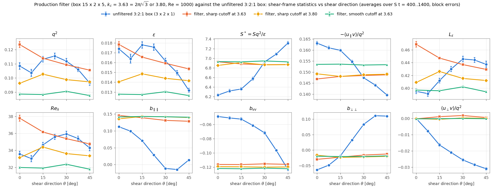
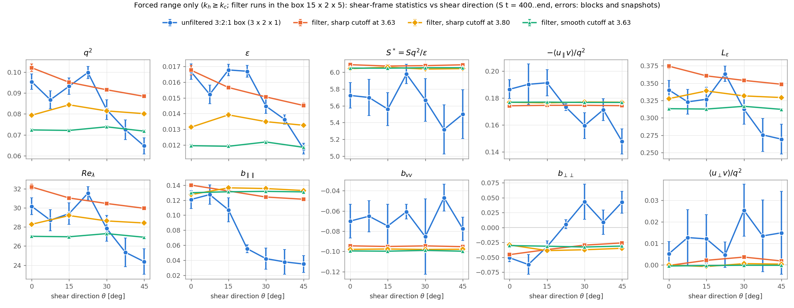
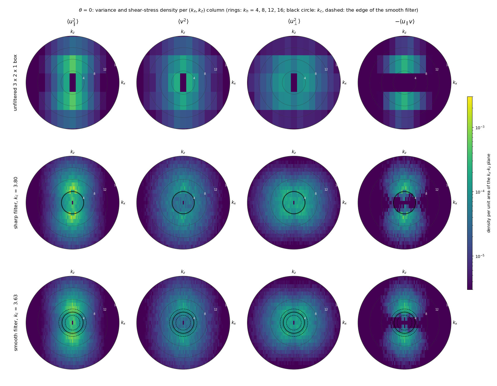
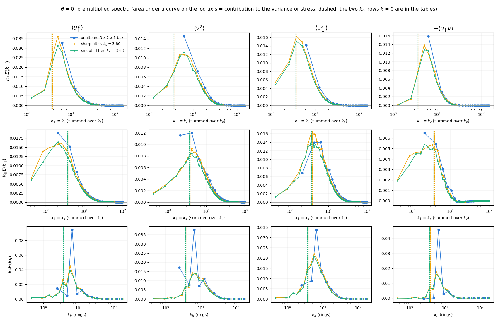
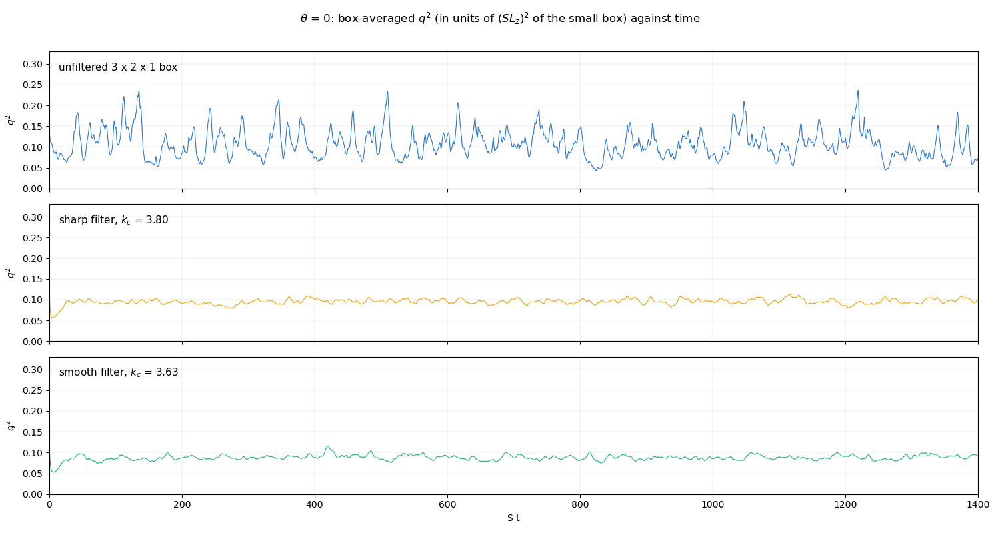

# Production filter: homogeneous shear turbulence that does not depend on the shear direction

Branch `production_filter` (2026-11-16).  This document reports what is
implemented, describes three cases (the original 3:2:1 box, the sharp
filter at k_c = 3.80 and the smooth filter at k_c = 3.63) and compares
them.  The input decks of every case are in
[`assets/campaign/`](assets/campaign/README.md).

**Result.**  With the smooth filter, the statistics of a 15 x 2 x 5 box
are independent of the angle theta between the mean shear and the box:
over theta = 0..45 deg the energy q2 varies by 3.4 %, S* by 0.3 %, the
anisotropy b_ij by 0.002, and the cross stress is zero.  The original
3:2:1 box varies by 18 % in q2, 16 % in S* and 0.07-0.17 in b_ij over the
same angles.  The sharp filter is as flat in the structure but keeps a
6.6 % variation of the level, which comes from the lattice rows next to
the cutoff.  The filtered flows have the integral scale of the 3:2:1 box
at theta = 0; they are more anisotropic (b_vv = -0.12 against -0.05),
largely because they lack the box-filling rollers of the small box.

Units: S = |dU/dy| = 1, lengths in units of the small box's width L_z = 1,
nu = 1/Re = 1e-3.  theta is measured from x towards z; the shear frame is
(par, v, perp) = (along the shear, along y, across the shear in the
plane).

## 1. The problem

Statistically stationary homogeneous shear turbulence in a periodic box
is limited by the box (Sekimoto, Dong & Jimenez, Phys. Fluids 28, 035101,
2016): in their 3:2:1 box one streak fills the width L_z, and L_z sets
every scale.  The x-z lattice of the box cannot follow the mean shear
(every lattice vector in the x-z plane is a material line of any shear
U = S y e_par), so when the shear direction is turned by theta, or turns
in time, the flow sees another box.  The statistics then mix the response
of the turbulence with the response of the box (section 4.2: S* from 6.2
to 7.3 between 0 and 45 deg).

A constraint that fixes the length scale and is isotropic in the x-z
plane removes the box from the problem, provided the box is much larger
than that scale.  A constraint defined in the frame of the shear is
excluded: it has to turn with the shear, and so acts on the flow whenever
the direction changes.

## 2. What is implemented

### 2.1 The filter

No mode is removed.  The length scale is prescribed through
the energy injection: the mean shear produces energy only in the Fourier
columns (k_x, k_z) with

    k_h = sqrt(k_x^2 + k_z^2) >= k_c .

The mean shear enters the fluctuation equations twice:

* the advection S y d/dx (+ S2 y d/dz), which tilts the wavevectors,
  k_y(t) = k_y0 - S k_x t - ...; with its share of the pressure it
  conserves energy.  It acts on every mode and is untouched (otherwise
  the lattices of the large and the small scales would differ and the
  triads would not close);
* the production term -v (S, 0, S2) of the momentum equation, the only
  source of energy.  It is multiplied, column by column, by

      G(k_h) = smoothstep((k_h/k_c - (1 - e))/(2 e)),   smoothstep(x) = x^2 (3 - 2 x) on 0..1,

  which rises from 0 at k_c (1 - e) to 1 at k_c (1 + e) and is 1/2 at
  k_c.  e = 0 is the sharp filter (a step; columns on k_h = k_c within
  1e-6 are forced).

The tilting changes k_y only, so k_h of a column is invariant: the
columns with G = 0 receive energy from the nonlinear transfer alone, are
tilted, and dissipate.  The energy budget is

    d(q2/2)/dt = -S <G u v> - S2 <G w v> - eps .

G depends on k_h only: nothing in the method knows the direction of the
shear, which may be steady, turned, or unsteady (`s2_*` of the deck).

### 2.2 Code

| where | what |
|---|---|
| deck group `&production` | `prod_kc` (k_c; 0 = off), `prod_edge` (e; 0 = sharp).  Commented example at the end of `hst.in` |
| `src/hst_production.f90` | `gprod(iz, ix)` = G, built once; 1 everywhere when off |
| `src/hst_equations.f90`, `buildrhs_prepare` | the lift-up term of eta is multiplied by G; the d2v equation gets the explicit term -(1 - G)(i alfa S + i beta S2) D1 v.  (Unfiltered, the production and the advection cancel in that equation; removing the production leaves the advection's half.)  With G = 1 the added terms are exact zeros |
| `src/hst_stats.f90` | `statistics/production_runtime.dat`, every `dt_stat`: time, number of columns with G < 1, <(1 - G) uu>, <(1 - G) vv>, <(1 - G) ww>, nu <(1 - G) grad u : grad u>, <G u v>, <G w v>, <(1 - G) u w>.  The first five are the unforced range (its variances and its dissipation, which in the mean equals the nonlinear flux into it), the stresses <G u v>, <G w v> are the ones that produce, the last turns the unforced variances into the shear frame |
| `tests/test_kelvin.f90`, four decks; `tests/test_kelvin_s2.f90`, 13 decks | see 2.3 |

### 2.3 Verification

A Kelvin mode in a column with filter value G has the closed form

    v(t) = v0 (k0^2/k(t)^2)^((1 + G)/2) exp(-nu int k^2 dt)

(G = 1: Kelvin's k^-2; G = 0: |v| k is constant and, for k_z = 0, the
energy is conserved exactly), and for G = 0 the vertical vorticity keeps
its initial value.  `tests/test_kelvin` checks it with
`kelvin_unforced.in` (G = 0: relative error 5e-9 in v, 3e-10 in eta),
`kelvin_unforced_s2.in` (with a constant S2: 4e-9, 2e-9),
`kelvin_halfforced.in` (G = 0.547 in a smooth edge: 5e-9) and
`kelvin_forced.in` (above the cutoff: unchanged).  The suite (22 runs) and
the regression (three decks at 1e-10) pass on the CPU build and on the GPU
build (RTX 3060); the NCCL build was not rerun.  In the turbulent runs
production/dissipation is 1.002 over S t = 400..1400 (the budget above
closes to the statistical drift).

With an oscillating spanwise shear the single-time checks above are not
enough: the filtered source terms see S2(t) at every Runge-Kutta substep, and
for k_x = 0 a Kelvin mode is back at its initial wavenumber after every
period, where v = v0 E whatever G is.  `tests/test_kelvin_s2` therefore
follows one column over 10 periods of S2 = A sin(omega t) (A/S = 1, S T =
1.75, 5.25, 14; k_x = 0 and 2 pi/15) at eight times per period and compares
v, eta, the energy (no gain for G = 0), the projection on exp(i k_y(t) y) and
gamma_y with the closed form for any S2(t) (`tests/KELVIN_S2.md`).  Errors
are 3e-6 or less (tolerance 1e-5); the time error is third order without
viscosity and second to 2.5th order with it (Crank-Nicolson), for the
oscillating runs as for the constant-S2 control.  Eight deliberate
bugs in the solver (S2 at the start of the step instead of the substep, wrong
sign or period of gamma_z, S2 missing or of the wrong sign in one of the two
filtered terms, ...) are each caught by at least one deck.

The campaign of section 3 was run with the first commit of this branch
before it was rebased on the current `main` and the deck group was named
`&production`.  The code pushed here reproduces that binary's fields
to round-off (5e-15 after 50 steps of three nonlinear decks: no filter,
sharp, smooth).  The run-time statistics changed their conventions with
`main` (section 5).

## 3. The three cases

All at Re = S L_z^2/nu = 1000 (L_z = 1 the width of the small box), the
same resolution (16 modes per unit length in x, 24 in z, 47.5 points in
y; dx/eta = 2, dy/eta = 1, dz/eta = 0.3 in the small box), shear of
magnitude 1 in the direction theta (S = cos theta, S2 = sin theta,
constant), CFL 0.7.

| | original 3:2:1 box | sharp filter, k_c = 3.80 | smooth filter, k_c = 3.63 |
|---|---|---|---|
| directory in `assets/campaign/` | `box_3x2x1` | `filter_sharp_kc3.80` | `filter_smooth_kc3.63` |
| box L_x x L_y x L_z | 3 x 2 x 1 | 15 x 2 x 5 | 15 x 2 x 5 |
| modes nx, ny, nz (dealiased x-z grid) | 48, 95, 24 (96 x 96) | 240, 95, 120 (384 x 384) | 240, 95, 120 (384 x 384) |
| lattice spacing dk_x, dk_z | 2.094, 6.283 | 0.419, 1.257 | 0.419, 1.257 |
| filter | none | G = 0 for k_h < 3.80, else 1 | G from 0 at 2.54 to 1 at 4.72, 1/2 at 3.63 |
| columns with G < 1 (half lattice, without (0,0)) | 0 | 45 | 67 |
| angles theta [deg] | 0, 7.5, ..., 45 (and to 90) | 0, 15, 30, 45 | 0, 15, 30, 45 |
| run length S t, averaged from | 2040, 200 | 1400, 400 | 1400, 400 |
| start | turbulent field of the reference setup | random field | random field |
| cost on one A100 | 0.008 s/step, about 1 h | 0.079 s/step, 4.6 h | 0.079 s/step, 4.5 h |

**Original 3:2:1 box.**  The box of Sekimoto et al.: L_x : L_y : L_z =
3 : 2 : 1, no filter.  Its lowest modes are the streak (0, +-2 pi), the
roller (+-2 pi/3, 0) and the oblique (+-2 pi/3, +-2 pi); the periodicity
is the only length scale.  At theta = 0 it is the reference flow; turning
the shear by theta changes which box the turbulence sees (at 90 deg the
box is 1 long and 3 wide).  The runs are those of the earlier lattice
study (branch `feature_honeycomb_from_main`).

**Smooth filter, k_c = 3.63.**  The box of the first case enlarged five
times in x and z, so that the lattice is five times finer in both
directions of the wavenumber plane.  k_c = 2 pi/sqrt(L_x L_z) = 2 pi/sqrt 3:
the forcing wavelength l_f = 2 pi/k_c = 1.73 is the side of the square
with the area of the 3 x 1 box.  The edge e = 0.3 spreads the cutoff over
k_h = 2.54..4.72, about two lattice spacings in k_z and five in k_x.

**Sharp filter, k_c = 3.80.**  The same box with a step at 3.80.  The
value was chosen against the sharp filter at 3.63
(`filter_sharp_kc3.63`, decks included): there the row k_z = 3.77 of
modes that are long along the shear at theta = 0 lies just inside the
forced range, and q2 falls monotonically by 16 % from 0 to 45 deg.  At
3.80 that row is unforced.

## 4. Comparison

Definitions: q2 = <u_i u_i>; eps = nu <du_i/dx_j du_i/dx_j>; S* = S q2/eps;
L_eps = (q2/3)^(3/2)/eps; Re_lambda = (q2/3) sqrt(15/(nu eps)); b_ij =
<u_i u_j>/q2 - delta_ij/3 in the shear frame; rho_ij the correlation
coefficients.  Errors in brackets are standard errors of the last digits
from 50-time-unit blocks.  The (0,0) column (the distortion of the mean
profiles) is not part of the fluctuation in these numbers (section 5).
Tables: [`assets/campaign/results/`](assets/campaign/results/).

### 4.1 The flows at theta = 0

| quantity | original 3:2:1 | sharp 3.80 | smooth 3.63 |
|---|---|---|---|
| q2 | 0.1085 (24) | 0.0962 (6) | 0.0886 (7) |
| eps | 0.01741 (43) | 0.01404 (9) | 0.01278 (10) |
| S* | 6.23 (3) | 6.85 (1) | 6.93 (1) |
| -<u_par v>/q2 | 0.1631 (8) | 0.1492 (2) | 0.1535 (2) |
| production/dissipation | 1.00 | 1.002 | 1.002 |
| L_eps | 0.395 (4) | 0.409 (1) | 0.397 (2) |
| Re_lambda | 33.6 (3) | 33.1 (1) | 32.0 (1) |
| b_par | 0.112 (2) | 0.136 (1) | 0.142 (1) |
| b_vv | -0.049 (2) | -0.119 (0) | -0.122 (0) |
| b_perp | -0.064 (1) | -0.017 (1) | -0.020 (1) |
| rho_par,v | -0.458 (2) | -0.471 (1) | -0.484 (0) |
| rms/mean of q2(t) | 0.31 | 0.057 | 0.065 |

* **Scale.**  L_eps of the filtered flows equals that of the small box
  within 4 % (smooth: 0.5 %), and Re_lambda within 5 %: a cutoff at
  l_f = sqrt 3 gives the scale that the 3 x 1 periodicity gives.
* **Level.**  q2 is 11 % (sharp) and 18 % (smooth) below the small box,
  eps 19 % and 27 %.  The smooth filter is lower than the sharp ones
  because production is tapered up to k_h = 4.72.
* **Structure.**  The filtered flows are more "sheared" by 10 % in S* and
  less efficient by 6-9 % in the stress ratio.  The largest difference is
  the anisotropy: the vertical velocity holds 21 % of q2 against 28 % in
  the small box, the cross-shear component 31 % against 27 %.  Sections
  4.3 and 4.4 trace most of it to the roller of the small box.
* **Sharp against smooth.**  The two filters give the same structure (S*,
  b_ij within 0.006, rho within 0.013).  They differ in the level, by
  8 % at theta = 0.

### 4.2 Dependence on the shear direction

Variation over theta = 0..45 deg, (max - min)/mean for the positive
quantities and max - min for the others:

| quantity | original 3:2:1 (7 angles) | sharp 3.80 (4) | smooth 3.63 (4) | sharp 3.63 (4) |
|---|---|---|---|---|
| q2 | 17.7 % | 6.6 % | 3.4 % | 16.0 % |
| eps | 28.6 % | 5.7 % | 3.1 % | 15.2 % |
| S* | 16.2 % (6.23-7.32) | 0.9 % (6.85-6.91) | 0.3 % (6.92-6.94) | 0.9 % |
| -<u_par v>/q2 | 15.4 % (0.140-0.163) | 0.8 % | 0.3 % | 1.3 % |
| L_eps | 12.8 % | 4.1 % | 2.0 % | 8.8 % |
| Re_lambda | 8.4 % | 3.7 % | 1.8 % | 8.4 % |
| b_par | 0.127 | 0.0071 | 0.0022 | 0.0173 |
| b_vv | 0.075 | 0.0007 | 0.0009 | 0.0010 |
| b_perp | 0.174 | 0.0068 | 0.0022 | 0.0172 |
| max abs <u_perp v>/q2 | 0.031 | 0.0006 | 0.0003 | 0.0018 |
| max abs rho_par,perp | 0.32 | 0.005 | 0.002 | 0.023 |

q2 at theta = 0 / 15 / 30 / 45 deg:

| case | 0 | 15 | 30 | 45 |
|---|---|---|---|---|
| original 3:2:1 | 0.1085 (24) | 0.1133 (20) | 0.1119 (21) | 0.0964 (18) |
| sharp 3.80 | 0.0962 (6) | 0.1027 (12) | 0.0988 (9) | 0.0972 (8) |
| smooth 3.63 | 0.0886 (7) | 0.0883 (6) | 0.0905 (7) | 0.0875 (6) |
| sharp 3.63 | 0.1237 (23) | 0.1140 (9) | 0.1094 (8) | 0.1055 (10) |

* **Original box.**  Every quantity drifts with theta.  The turbulence
  becomes more sheared (S* 6.2 -> 7.3, b_vv -0.05 -> -0.12), the
  along-shear and cross-shear components exchange their roles (b_par
  0.11 -> 0.01, b_perp -0.06 -> +0.11), and a cross stress <u_perp v>
  appears that is zero by symmetry in an unbounded flow (3 % of q2 at 45
  deg, with rho_par,perp = 0.32): the fluctuations are turned away from
  the shear frame by the box.
* **Smooth filter.**  The normalised statistics are flat to their error
  bars (S* within 0.02, b_ij within 0.002, the cross stress within
  0.0003 q2).  The level varies by 3.4 % with block errors of 0.7 %: the
  30 deg run is 2.7 % (about three standard errors) above the other
  three, which agree within 1.3 %.
* **Sharp filter at 3.80.**  The structure is as flat as with the smooth
  edge, except for a step of 0.007 in b_par and b_perp between 0 and 15
  deg.  The level varies by 6.6 %, not monotonically: theta = 0 is the
  lowest.  With the cutoff at 3.63 theta = 0 is the highest and the level
  falls monotonically by 16 %.  The only difference between the two at
  theta = 0 is whether the lattice row k_z = 3.77 is forced.  The angle
  dependence of a sharp filter is therefore the position of a few lattice
  rows of long modes relative to the circle, a discretisation effect that
  the smooth edge averages out.

### 4.3 The forced range alone

The unforced range of the filtered flows (k_h below the cutoff, 17-18 %
of q2) has no counterpart in the small box, and the small box has one
mode below k_c = 3.63, the roller (+-2 pi/3, 0), that the filter does not
force.  Statistics built only from the modes at or above the forcing
shell compare like with like:

| theta = 0, forced range | original 3:2:1 | sharp 3.80 | smooth 3.63 |
|---|---|---|---|
| q2 | 0.095 (4) | 0.0794 (5) | 0.0724 (5) |
| eps | 0.0167 (5) | 0.0131 (1) | 0.0120 (1) |
| S* | 5.72 (15) | 6.04 (1) | 6.05 (1) |
| -<u_par v>/q2 | 0.187 (7) | 0.177 (0) | 0.177 (0) |
| L_eps | 0.340 (14) | 0.328 (1) | 0.313 (1) |
| Re_lambda | 30.2 (9) | 28.3 (1) | 27.0 (1) |
| b_par | 0.121 (12) | 0.127 (1) | 0.130 (1) |
| b_vv | -0.070 (17) | -0.098 (0) | -0.100 (0) |
| b_perp | -0.051 (6) | -0.029 (1) | -0.030 (1) |
| variation of q2 over 0..45 deg | 41 % | 6.1 % | 2.8 % |
| variation of S* | 12 % | 0.4 % | 0.1 % |

How it is computed.  Filtered runs: the total minus the unforced share
that the code integrates at run time with the weight 1 - G, so the
"forced range" is G-weighted (for the sharp filter exactly k_h >= k_c).
Small box: the total minus the roller column, taken from the 7-9 stored
velocity snapshots of each run (S t >= 400, as the totals in this
table); its errors are therefore ten times larger.  The roller holds 12 % of q2 at theta = 0 (18 % of <v^2>, 4 % of
eps, no shear stress) and 33 % at 45 deg.

* At theta = 0 the filtered flows agree with the small box within about
  two standard errors in S* (2.2), the stress ratio, b_par and b_vv.  The
  difference in b_vv shrinks from 0.073 (all modes) to 0.030 (2 sigma).
* The level of the forced range is 17 % (sharp) and 24 % (smooth) below
  the small box's.
* The small box's forced range depends on theta even more than its total
  (q2 0.095 -> 0.065), while the roller grows: the box redistributes
  energy between the two as the shear turns.

### 4.4 Where the energy is

From the velocity snapshots at theta = 0 (8 for the small box, 5 for each
filtered run; par = x, perp = z).  Shares of q2, <v^2> and -<u_par v>:

| share of q2 in | original 3:2:1 | sharp 3.80 | smooth 3.63 |
|---|---|---|---|
| k_h < 3.63 | 0.12 | 0.15 | 0.17 |
| 3.63 <= k_h < 6.28 | 0.07 | 0.35 | 0.34 |
| 6.28 <= k_h < 12.6 | 0.64 | 0.37 | 0.38 |
| k_h >= 12.6 | 0.17 | 0.12 | 0.12 |
| row k_perp = 0 (rollers, uniform across the shear) | 0.25 | 0.055 | 0.057 |
| row k_par = 0 (uniform along the shear) | 0.20 | 0.044 | 0.052 |
| long streaks of the small box's width or narrower, abs k_par < 2 pi/3, abs k_perp >= 2 pi | 0.20 | 0.13 | 0.14 |

| share of <v^2> / of -<u_par v> in | original 3:2:1 | sharp 3.80 | smooth 3.63 |
|---|---|---|---|
| k_h < 3.63 | 0.19 / -0.01 | 0.08 / 0.01 | 0.09 / 0.02 |
| 3.63 <= k_h < 6.28 | 0.09 / 0.00 | 0.26 / 0.44 | 0.27 / 0.43 |
| 6.28 <= k_h < 12.6 | 0.51 / 0.91 | 0.44 / 0.48 | 0.44 / 0.49 |
| k_h >= 12.6 | 0.22 / 0.10 | 0.22 / 0.07 | 0.20 / 0.07 |
| row k_perp = 0 (rollers) | 0.32 / -0.01 | 0.05 / -0.01 | 0.04 / -0.01 |
| row k_par = 0 | 0.18 / 0.39 | 0.04 / 0.07 | 0.05 / 0.09 |

* **Small scales coincide.**  For k_perp >= 2 pi the premultiplied
  spectra of all three components and of the stress fall on one curve
  (top row of the second figure): the filtered flows contain the small
  box's turbulence.
* **Rollers.**  A third of <v^2> of the small box sits in the row
  k_perp = 0, a fifth in the single mode (+-2 pi/3, 0), which carries no
  stress.  In the filtered flows the whole row holds 4-5 % of <v^2>.
  These modes fill the small box across the shear; they are what makes
  its b_vv less negative.
* **Wider streaks.**  The filtered flows add the band between the cutoff
  and 2 pi (wavelengths 1 to 1.73 across the shear), which the small box
  cannot hold: a third of q2 and 43 % of the shear stress.  The stress
  peaks at k_perp = 5.0 (wavelength 1.25) instead of the box's 2 pi.
* **Length.**  In the small box 39 % of the stress comes from modes that
  are uniform along the shear (k_par = 0); in the filtered flows 7-9 %.
  The filter limits the width of the structures, not their length, but
  the 15-long box resolves the long end of the spectrum in both cases:
  the time-averaged density of q2 per unit k_par is level between
  k_par = 0 and 0.42 for the smooth filter and has its maximum at
  k_par = 0.84 (wavelength 7.5) for the sharp one at 3.80; the row
  k_par = 0 holds 5.2 % and 4.4 % of q2.  (With the sharp filter at 3.63,
  whose forced range begins with the long row k_z = 3.77, the density
  keeps rising to k_par = 0, which holds 7.0 % of q2, and 9.2 % in a
  9-long box.)
* **Sharp against smooth.**  The spectra of the two filtered flows
  differ only next to the cutoff, where the sharp one has more energy in
  the first forced rows (the peak of k_perp E_par at k_perp = 5.0 is
  15 % higher).

### 4.5 The unforced range and the budget

| theta = 0 (range over the four angles) | sharp 3.80 | smooth 3.63 |
|---|---|---|
| unforced share of q2, <(1 - G) u_i u_i>/q2 | 0.173 (0.173-0.178) | 0.183 (0.181-0.184) |
| unforced share of eps | 0.063 | 0.064 |
| producing share of the stress, <G u_par v>/<u_par v> | 0.980 | 0.942 |
| production/dissipation | 1.002 | 1.002 |
| b_par, b_vv, b_perp of the unforced range | 0.176, -0.221, 0.045 | 0.194, -0.222, 0.028 |

The unforced range is fed by the nonlinear transfer from above the cutoff
at a rate of 6 % of the dissipation and holds 17-18 % of the energy.  It
is flat (b_vv = -0.22: the vertical velocity has a third of its isotropic
share) and steady: the energy does not pile up at the box scale (with
the sharp filter at 3.63 the share is 0.165 in a 9 x 2 x 3 box and 0.169
in the 15 x 2 x 5 one, and the (0,0) column holds 0.1-0.3 % of q2).  With the smooth edge 6 % of the stress falls where
G < 1 and produces less; with the sharp one 2 % of the stress is carried
by unforced modes.

### 4.6 Time dependence

The box average of q2 bursts in the small box (rms/mean 0.31; one
structure fills it) and is nearly steady in the filtered flows (0.057 and
0.065).  The ratio is the one of 25 independent small boxes
(0.31/sqrt 25 = 0.062): the 15 x 2 x 5 box averages over as many
structures as its area holds.  Per unit of simulated time a filtered run
costs ten times more and the variance of its mean q2 is about 17 times
smaller (block errors 0.7 % over 1000 time units against 2.2 % over
1840).

## 5. Rerunning the cases, and the conventions of the numbers

[`assets/campaign/README.md`](assets/campaign/README.md) lists the decks
and how to run them.  Two things differ between the campaign's outputs
and what the code of this branch writes:

* **Run-time statistics.**  The campaign binary wrote `Runtimedata`,
  `variances_runtime.dat` and `production_runtime.dat` into the run
  directory as box-height integrals (L_y/2 <.> for the energy, the
  stresses and the filter diagnostics, L_y <.> for the variances in the
  order uu, ww, vv, uw, the dissipation without nu) and did not count the
  (0,0) column.  The code of this branch follows `main`: files in
  `statistics/`, plain averages (energy = <u_i u_i>/2, dissipation with
  nu, variances in the order uu, vv, ww, uw), and the (0,0) column's
  fluctuation about its box mean is part of the fluctuation (in
  `production_runtime.dat` it belongs to the unforced range).  With the
  column, q2 is larger by 0.1-0.3 % in the filtered flows and by about
  6 % in the small box (2-15 % in single snapshots).  The scripts in
  `assets/campaign/tools/` are the ones that produced the tables and
  figures; they read the campaign's layout.
* **Start.**  The small-box runs started from a turbulent field of the
  reference setup; the decks start from the code's random field
  (amplitude 0.003 at k = 8, which transitions).  The filtered runs
  started from the random field as the decks do.  Only the transient
  differs.

## 6. Limits and open points

* **Level of the sharp filter.**  6.6 % at k_c = 3.80 and 16 % at 3.63 in
  the 15 x 2 x 5 box; a 9 x 2 x 3 box at 3.63 gave the same trend as the
  larger one (14 %).  The smooth edge is the recommended form.
* **The 30 deg point of the smooth filter** is about three standard
  errors above the others (q2 +2.7 %).  Whether this is a residual lattice effect or
  the statistics of one run is not known; more angles or a second
  realisation would tell.
* **Box shape and length.**  The long end of the k_par spectrum is
  resolved at theta = 0 (section 4.4); it has not been checked at the
  other angles, and the 3:1 shape of the enlarged box is three times
  shorter along the shear at 90 deg than at 0.  Angles above 45 deg have
  not been run with the filter.  A square box (10.5 x 2 sqrt 3 x 10.5,
  smooth edge, four angles) is running.
* **Height.**  L_y/l_f = 1.15, where Sekimoto et al. find boxes with
  L_y/L_z < 1 vertically constrained and recommend about 2.  The square
  box above has L_y = 2 sqrt 3 (ratio 2).
* **Cutoff at the small box's width.**  k_c = 2 pi (l_f = 1) at Re = 1000
  does not sustain turbulence (S l_f^2/nu = 1000 against 3000 here; all
  angles laminar by S t = 130).  It is the present flow at Re = 3000, or
  the taller box above.
* **Difference to the 3:2:1 box at theta = 0.**  S* 6.9 against 6.2, b_vv
  -0.12 against -0.05.  Removing the small box's roller explains part of
  it (section 4.3: the forced ranges agree within 2 sigma, with large
  errors on the small-box side); an exact statement needs the roller's
  contribution accumulated at run time in the small box.
* **Unsteady shear direction.**  The filter is defined for any S2(t); the
  linear solver is verified for it (section 2.3, `tests/KELVIN_S2.md`), no
  turbulent run has been made with it yet.
